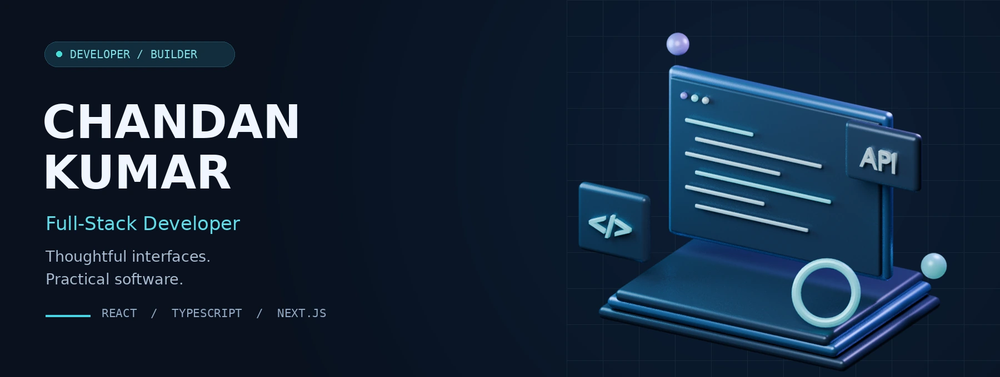

<!-- Profile-only repository. All linked project repositories remain independent. -->

  

# Chandan Kumar

### Full-Stack Developer · Thoughtful interfaces. Practical software.

Building web applications that make everyday tasks simpler. 
Based in India · Working with React, TypeScript and the modern web.

[Explore my work](#selected-work) · [Technology](#technology) · [Engineering approach](#engineering-approach)

---

### A little about me

I build across the web stack, from responsive interfaces to APIs and data workflows. My projects explore document productivity, audio streaming and interactive web experiences. I care about clear design, accessible interactions and software that is straightforward to maintain.

### Selected work

<table>
<tr>
<td width="50%" valign="top">
<h3>01 / DocToolz</h3>

Image and PDF utilities designed around browser-based processing, with Hindi and English support.

<code>React</code> <code>TypeScript</code> <code>Vite</code> <code>PDF tools</code>

<a href="https://github.com/chandan-itian/doctoolz"><strong>Explore repository →</strong></a>
</td>
<td width="50%" valign="top">
<h3>02 / RadioVerse India</h3>

An internet radio discovery and streaming project with favorites, sleep timers and a bilingual interface.

<code>Next.js</code> <code>TypeScript</code> <code>Zustand</code> <code>Prisma</code>

<a href="https://github.com/chandan-itian/Radio-Verse-India"><strong>Explore repository →</strong></a>
</td>
</tr>
<tr>
<td width="50%" valign="top">
<h3>03 / Personal Portfolio</h3>

An interactive developer portfolio exploring distinctive visual design, reusable components and responsive layouts.

<code>Next.js</code> <code>UI / UX</code> <code>Playwright</code>

<a href="https://github.com/chandan-itian/Personal-Portfolio"><strong>Explore repository →</strong></a>
</td>
<td width="50%" valign="top">
<h3>What I am exploring</h3>

Cloudflare Workers and D1, AI-assisted development, and practical applications for small businesses.

<code>Edge computing</code> <code>AI tools</code> <code>Product thinking</code>

<a href="https://github.com/chandan-itian?tab=repositories"><strong>Browse public repositories →</strong></a>
</td>
</tr>
</table>

### Technology

| Area | Tools I work with |
| :--- | :--- |
| Interface | React · Next.js · TypeScript · JavaScript |
| Styling | Tailwind CSS · HTML · CSS · Responsive design |
| Application | Node.js · API routes · Zod · Prisma |
| Tooling | Git · GitHub · Vite · Playwright · Vitest |
| Exploring | Cloudflare Workers · D1 · Supabase · AI integrations |

### Engineering approach

- **Design for people:** mobile-friendly layouts, readable content and accessible interactions.
- **Build with care:** clear boundaries, validated inputs and thoughtful handling of data.
- **Keep it maintainable:** reusable components, focused tests and useful documentation.
- **Stay practical:** choose tools that fit the problem and keep operating costs in mind.

---

<strong>Useful ideas. Carefully built.</strong> 
Explore a project, read the code, and follow along as I keep building.

